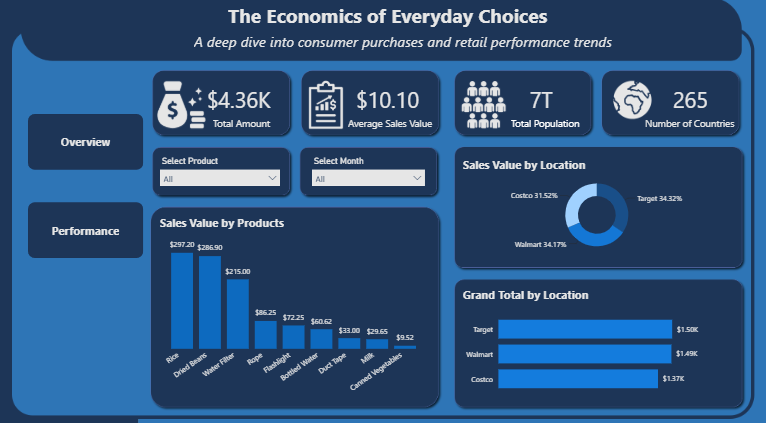
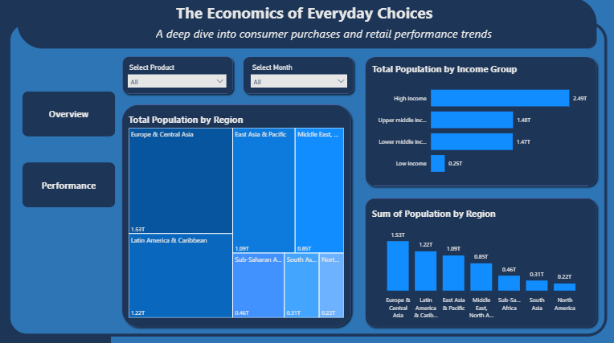

# The Economics of Everyday Choices: Retail Purchases Dashboard
### A deep dive into consumer purchases and retail performance trends

#### About the Project

**The Economics of Everyday Choices** is an interactive Microsoft Power BI dashboard designed to explore retail purchase values across stores and products, alongside global population data by region and income group.

The report has two pages. The **Overview** page looks at purchase values by product and store. The **Performance** page looks at world population by region and income group.

The project is an analytical and data visualisation exercise intended to demonstrate how business and public data can be transformed into meaningful, interactive insights. The purchase data comes from a practice dataset (an "Apocalypse Food Prep" Power Query tutorial workbook) and covers a small sample, so it should be interpreted in the context of the project rather than as independently verified business results.

#### Project Objectives

The dashboard was created to explore five main questions:

1. Which products generate the highest sales value?
2. How is sales value split across Target, Walmart and Costco?
3. How do the total amount and average sales value compare across the dataset?
4. How is population distributed across world regions?
5. How is population distributed across income groups?

#### Dashboard Preview

| Overview Page | Performance Page |
|---|---|
|  |  |

#### Dashboard Components

##### 1. Overview KPIs

The Overview page opens with four key performance indicators (KPIs):

- **Total Amount:** $4.36K
- **Average Sales Value:** $10.10
- **Total Population:** 7T
- **Number of Countries:** 265

##### 2. Sales Value by Products

The column chart compares sales value across nine products:

- Rice — $297.20
- Dried Beans — $286.90
- Water Filter — $215.00
- Rope — $86.25
- Flashlight — $72.25
- Bottled Water — $60.62
- Duct Tape — $33.00
- Milk — $29.65
- Canned Vegetables — $9.52

Rice, Dried Beans and Water Filter lead the chart by a wide margin.

##### 3. Sales Value by Location

The donut chart shows each store's share of total sales value:

- Target — 34.32%
- Walmart — 34.17%
- Costco — 31.52%

The three stores are close, with Target slightly ahead.

##### 4. Grand Total by Location

The bar chart compares the Grand Total for each store:

- Target — $1.50K
- Walmart — $1.49K
- Costco — $1.37K

##### 5. Total Population by Region

The Performance page includes a treemap and a column chart showing population by region:

- Europe & Central Asia — 1.53T
- Latin America & Caribbean — 1.22T
- East Asia & Pacific — 1.09T
- Middle East, North Africa, Afghanistan & Pakistan — 0.85T
- Sub-Saharan Africa — 0.46T
- South Asia — 0.31T
- North America — 0.22T

##### 6. Total Population by Income Group

The bar chart compares population across World Bank income groups:

- High income — 2.49T
- Upper middle income — 1.48T
- Lower middle income — 1.47T
- Low income — 0.25T

#### Key Insights

The dashboard provides several initial observations that can guide further analysis.

##### a. Product Concentration

Rice, Dried Beans and Water Filter together account for about 73% of total sales value ($799.10 of $1,090.39), making them the dominant products in the dataset.

##### b. Store Comparison

Target, Walmart and Costco are closely matched. Target leads with 34.32% of sales value, Walmart follows with 34.17% and Costco has 31.52%.

##### c. Regional Population

Europe & Central Asia has the largest displayed population total at 1.53T, followed by Latin America & Caribbean at 1.22T. North America is the smallest at 0.22T.

##### d. Income Group Population

High income has the largest displayed population total at 2.49T, while Low income has the smallest at 0.25T.

These observations are descriptive findings from the displayed dashboard. They do not, on their own, establish the causes of differences in purchases or explain the underlying economic conditions.

#### Tools Used

- **Microsoft Power BI** — Dashboard development, Data visualisation and Interactive reporting.
- **Power Query** — Data cleaning and Data transformation (unpivoting, filtering, merging queries).

#### Visualisations

The dashboard uses a combination of:

- KPI cards
- Column chart
- Horizontal bar charts
- Donut chart
- Treemap
- Interactive slicers
- Page navigation buttons

#### Interactive Features

The dashboard is designed to support interactive exploration rather than simply present static figures.

##### i. Filter by Product

Use the Select Product slicer to examine the purchase data for a chosen product.

##### ii. Filter by Month

Use the Select Month slicer to explore the purchase data for a chosen month.

##### iii. Compare Stores

Explore the donut and bar charts to compare sales value across Target, Walmart and Costco.

##### iv. Identify Leading Products

Use the Sales Value by Products chart to compare product performance.

##### v. Explore Population by Region and Income Group

Use the treemap and bar charts on the Performance page to compare population across regions and income groups.

##### vi. Navigate Between Pages

Use the **Overview** and **Performance** buttons to move between the two pages.

#### Live Dashboard

[https://app.powerbi.com/view?r=eyJrIjoiNTdlNGFiZjItOTE1Zi00MjA1LTg0YTUtY2U0ZTk0YzlmNjk2IiwidCI6IjEwNGQ4MDQ4LWZkMGMtNDNkNS1hNjMwLWZjNjI5ZTVkYWI1OSJ9]

Kindly tap on the link above to view the interactive version of the  Live dashboard.

#### Why This Dashboard?

Purchase data and population data can be difficult to interpret when presented only as tables or individual figures.

**The Economics of Everyday Choices** brings both together in one interactive report, allowing us to move from an overall view of performance to more specific questions about:
Products, Stores, Average Sales Value, Regional Population, Income Groups, amongst others.

This structure helps us explore consumer purchases and wider economic context from several perspectives and identify areas that may warrant further analysis.

The dashboard also demonstrates the value of business intelligence tools in transforming data into insights that support decisions.

#### Author:
#### Naa Akweley Marley
LinkedIn: [Naa Akweley Marley](https://www.linkedin.com/in/naa-akweley-marley)